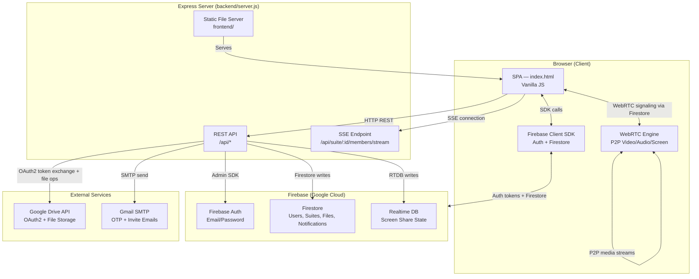
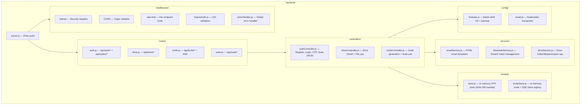
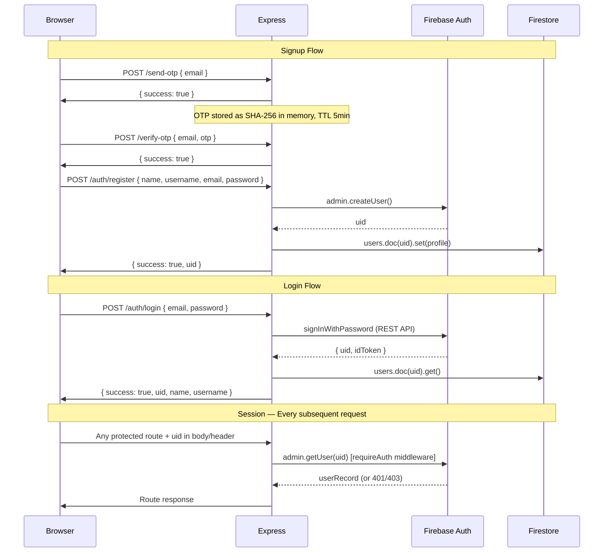
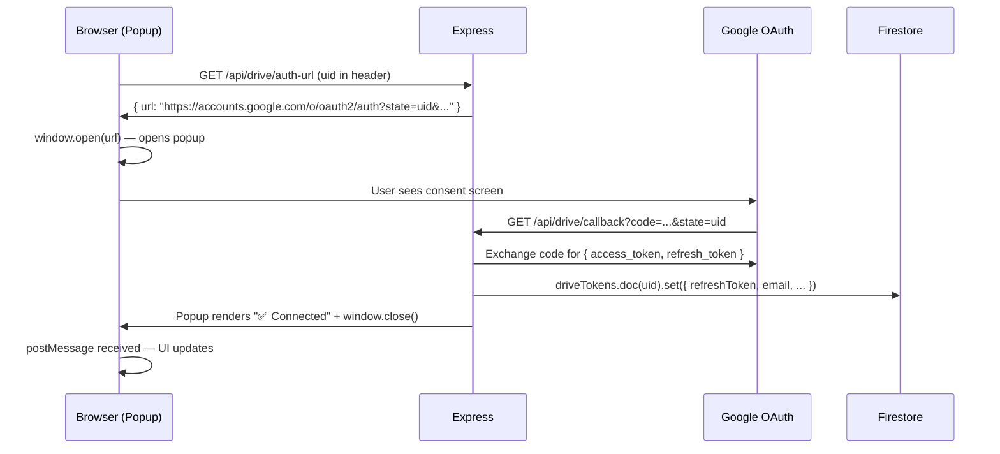
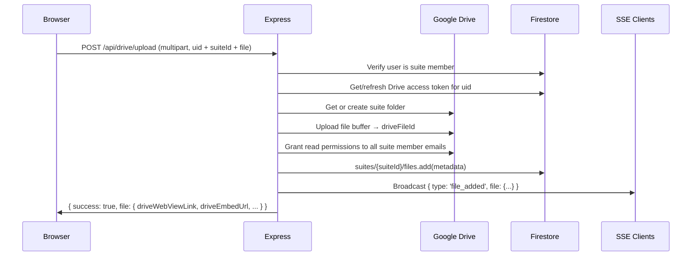
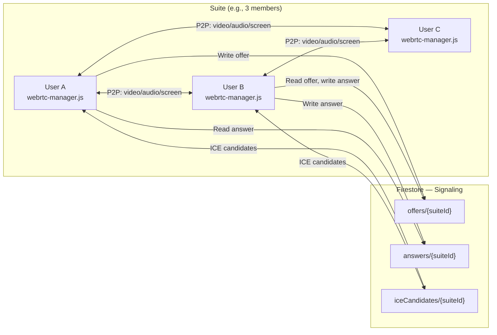
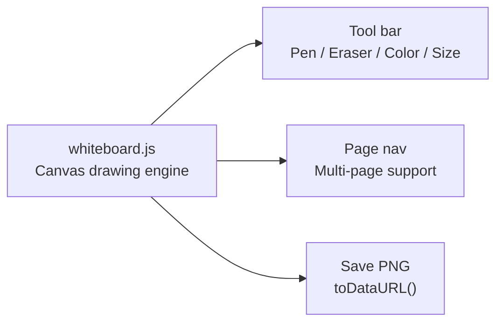
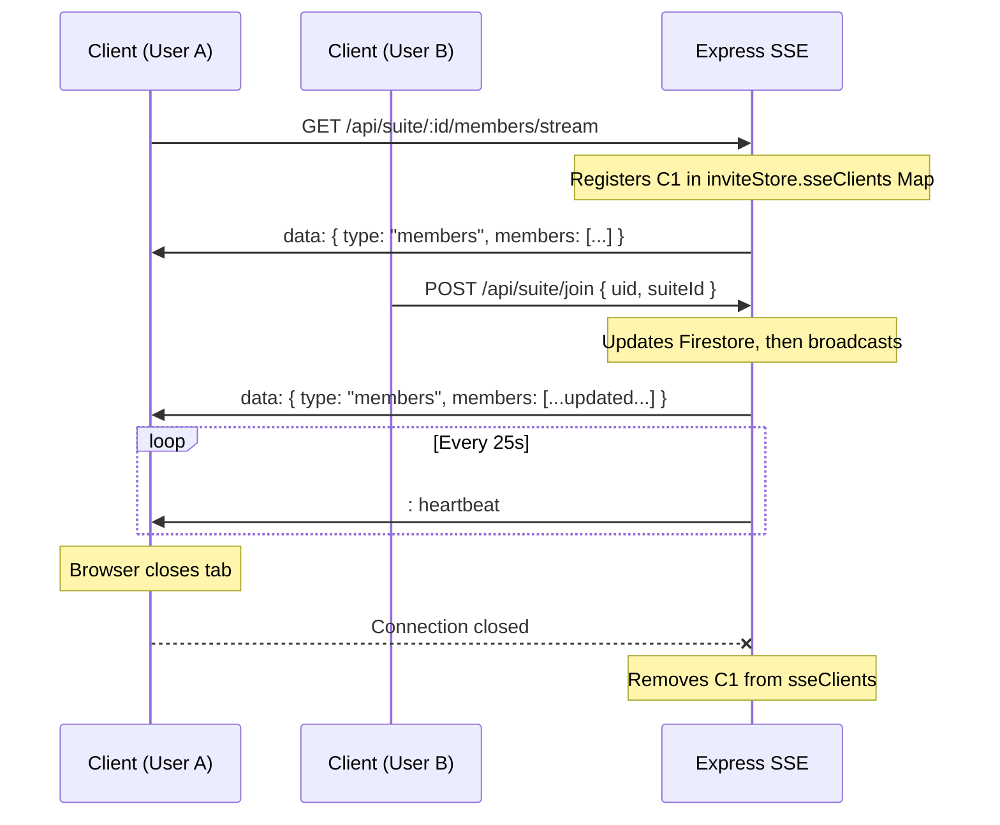
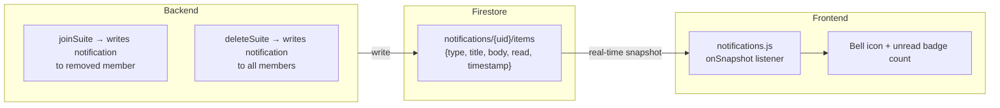

# CoLearn — Architecture

This document describes the complete system architecture of CoLearn — how the frontend, backend, Firebase, Google Drive, SMTP, WebRTC, and SSE components communicate.

---

## High-Level Overview

CoLearn is a **single-server SPA architecture**: the Express backend both serves the frontend static files and provides all REST API endpoints. Real-time features are layered on top via WebRTC (peer-to-peer) and Firebase Firestore (cloud sync) with Server-Sent Events (SSE) for server-push member updates.



---

## Component Architecture

### Frontend (SPA)

The frontend is a **single-page application** built with pure HTML, CSS, and Vanilla JavaScript. There is no build step — the browser loads `frontend/index.html` and all JS modules.

```mermaid
graph TD
    subgraph Frontend["frontend/"]
        IDX["index.html — SPA shell"]
        RTR["router.js — View navigation"]
        
        subgraph Views["js/views/"]
            LGN["login.js"]
            SGN["signup.js"]
            FGT["forgot.js"]
            DSH["dashboard.js"]
            WSP["workspace.js"]
        end
        
        subgraph Modules["js/ — Shared Modules"]
            API2["api.js — fetch() wrappers"]
            CFG["config.js — API_BASE, constants"]
            FBC["firebase-client.js — Client SDK init"]
            STA["state.js — Global app state"]
            UTL["utils.js — Toast, modal, alerts"]
        end
        
        subgraph Features["js/ — Feature Modules"]
            WBD["whiteboard.js — Canvas engine"]
            VID["video-call.js — WebRTC video"]
            SCR["screen-share.js — WebRTC screen"]
            CHT["private-chat.js — DM system"]
            INV["invite.js — Invite flow"]
            NTF["notifications.js — Bell + badge"]
            DOC["document-service.js — Drive viewer"]
            WBM["webrtc-manager.js — Peer connections"]
        end

        IDX --> RTR
        RTR --> Views
        Views --> Modules
        Views --> Features
    end
```



**View Routing:** The router intercepts hash changes (`#login`, `#dashboard`, `#workspace`, etc.) and renders the appropriate view without a page reload.

**State Management:** `state.js` holds the global mutable state (current user, active suite, WebRTC peers) as a plain JS object, shared across modules.

**Firebase Client SDK:** Used directly in the browser for:
- Listening to Firestore document changes (whiteboard sync, screen share state)
- Getting ID tokens for authenticated API calls
- Real-time notification updates

---

### Backend (Express Server)



**Startup Sequence:**
1. Load `.env` via `dotenv`
2. Initialize Nodemailer SMTP transporter
3. Initialize Firebase Admin SDK (loads `serviceAccountKey.json`)
4. Warm up Firebase Auth token (prefetch access token)
5. Register middleware (Helmet, CORS, JSON body parser, rate limiters)
6. Mount routes
7. Serve static frontend files from `../frontend`
8. Start HTTP server on `0.0.0.0:PORT`

---

### Authentication Flow



---

### Google Drive OAuth Flow

CoLearn uses **one Google Cloud OAuth client for the entire app**. Each user individually authorizes their own Google Drive — this is the same architecture as Notion, Slack, and Canva.



**Token Storage:** OAuth refresh tokens are stored in Firestore (`driveTokens` collection, keyed by UID). Access tokens are obtained on-demand by refreshing the stored refresh token.

**Drive Scope:** `https://www.googleapis.com/auth/drive.file` — the app can only access files it created. It cannot access the user's existing Drive files.

---

### File Upload Flow



---

### WebRTC Architecture

WebRTC peer connections are managed **entirely client-side** using Firebase Firestore as the signaling channel. The backend has no involvement in the WebRTC handshake.



Each pair of users establishes a separate RTCPeerConnection. With N members, there are N×(N-1)/2 peer connections.

---

### Whiteboard Architecture

The whiteboard uses an HTML5 `<canvas>` element. Drawing state is **not currently persisted** — it is local to the session.



Future: Persistent whiteboard sync via Firebase Realtime Database or CRDT.

---

### Server-Sent Events (SSE)

SSE provides **server-push member list updates** without polling.



**In-memory SSE store:** `inviteStore.sseClients` is a `Map<suiteId, Set<Response>>` — each entry holds the active `res` objects for all connected clients watching that suite.

---

### Notification System

Notifications are stored in Firestore and read by the Firebase Client SDK in real-time.



---

## Data Model (Firestore)

### `users/{uid}`
```
{
  name: string,
  username: string,
  email: string,
  createdAt: timestamp
}
```

### `suites/{suiteId}`
```
{
  name: string,
  ownerUid: string,
  type: "permanent" | "quick",
  members: [{ uid, name, username, isHost, joinedAt }],
  memberUids: string[],
  createdAt: timestamp,
  updatedAt: timestamp
}
```

### `suites/{suiteId}/files/{fileId}`
```
{
  driveFileId: string,
  driveFolderId: string,
  fileName: string,
  mimeType: string,
  fileSize: number,
  uploadedAt: timestamp,
  ownerUid: string,
  ownerEmail: string,
  uploadedByName: string,
  driveWebViewLink: string,
  driveDownloadLink: string,
  driveEmbedUrl: string,
  permissionIds: { [email]: permissionId }
}
```

### `driveTokens/{uid}`
```
{
  refreshToken: string,
  email: string,
  connectedAt: timestamp
}
```

### `notifications/{uid}/items/{notifId}`
```
{
  type: string,
  title: string,
  body: string,
  icon: string,
  data: object,
  timestamp: timestamp,
  read: boolean
}
```

### `screenSharing/{suiteId}`
```
{
  isSharing: boolean,
  presenterUid: string,
  presenterName: string,
  startedAt: timestamp,
  suiteId: string
}
```

---

## Security Architecture

| Layer | Mechanism |
|-------|-----------|
| HTTP Headers | Helmet (X-Frame-Options, CSP, HSTS, etc.) |
| CORS | Explicit origin allowlist via `ALLOWED_ORIGINS` env var |
| Authentication | Firebase Admin SDK `getUser(uid)` on every protected route |
| Rate limiting | Per-endpoint express-rate-limit (5–200 req/window) |
| Input validation | express-validator on auth routes |
| OTP security | SHA-256 hashed, 5-min TTL, max 5 attempts |
| Drive scope | `drive.file` only — cannot access user's existing files |
| Secrets | All credentials gitignored, loaded via environment variables |
| Firebase rules | Firestore security rules enforce per-user data isolation |
